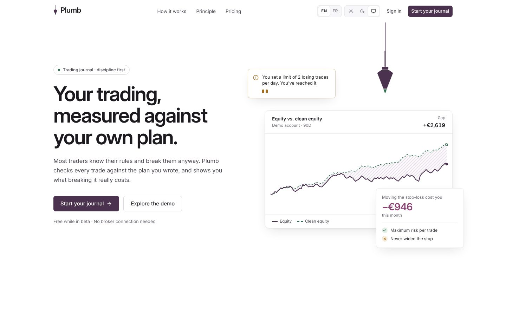
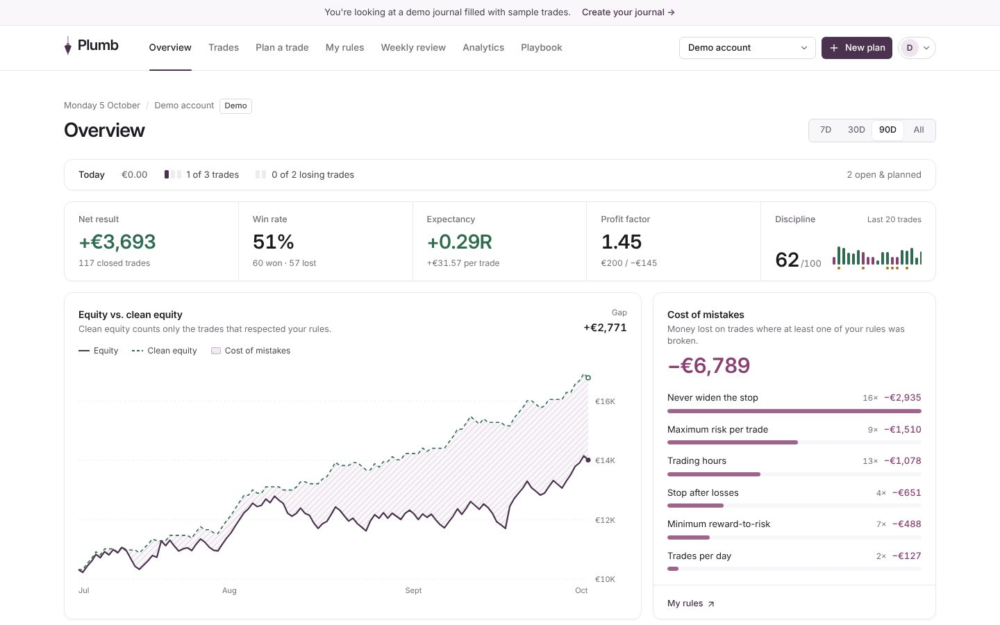
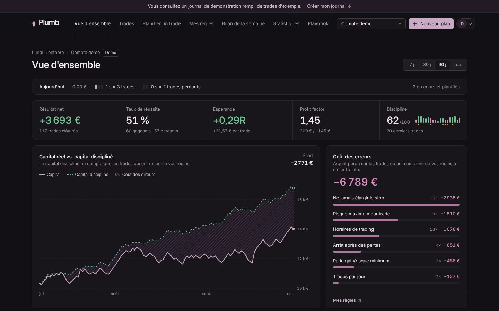

# Plumb

**Your trading, measured against your own plan.**

Plumb is a private trading journal built around discipline. You write a plan before each trade,
Plumb checks every trade against the rules *you* wrote, and shows what breaking them really costs.

> The app is a mirror, not an advisor. It only shows traders their own data and their own rules.
> It never tells them what to trade.



| Overview (light) | Overview (dark) |
| --- | --- |
|  |  |

## What's in this version (MVP)

- **Trade planner**: entry, stop, target, reason, setup checklist and emotion. Position size, amount at risk and
  reward:risk are computed from the account's own risk setting. The plan is checked live against your rules.
- **Plan vs. reality**: every trade keeps its *initial* stop (R is always measured against it). A moved stop, a changed
  size or a different entry are shown side by side, with a price ladder.
- **Personal rules engine**: max risk per trade, always a stop, minimum R:R, trades per day, stop after N losses,
  never widen the stop, trading hours. Each rule shows how often it was broken and what it cost.
- **Cost of mistakes and clean equity**: money lost on rule-breaking trades, rule by rule, and the equity curve you
  would have with only the trades that respected your plan.
- **Limit reminders** in your own words (“You set a limit of 2 losing trades per day. You've reached it.”).
- **Behaviour statistics**: discipline score, results by emotion, after a loss, by hour, by setup, R distribution,
  and a sample size indicator on every number.
- **Descriptive insights** computed from the journal (no AI, no advice), each ending with an open question.
- **Journal** (list + calendar), **Playbook** (setups with checklists and real stats), **Weekly review**.
- Multiple accounts (demo / live / prop), CSV export, **EN / FR**, **light / dark / system** themes.
- **Demo mode** with a realistic sample journal, available without an account.

## Stack

| Layer | Choice |
| --- | --- |
| App | Next.js 16 (App Router, React 19, TypeScript), Server Actions, Node.js runtime |
| Data / Auth / Storage | Supabase (Postgres + Row Level Security, Supabase Auth via `@supabase/ssr`) |
| Hosting | Vercel (functions in `cdg1`, Paris) |
| UI | Tailwind CSS v4, custom SVG charts, Lucide icons, self-hosted Inter font |
| Validation | Zod |

Colour palette: white pages, plum ink `#4B3350`, dusty mauve `#8C6A87`, sage green `#2F6B4F` (gains).
Losses are shown in plum, not red, with an explicit sign: the journal describes, it doesn't judge.

## Getting started

```bash
npm install
cp .env.example .env.local   # optional: without it the app runs in demo mode
npm run dev
```

Open http://localhost:3000. Without Supabase variables every app page runs on the demo journal.

### 1. Create the Supabase project

1. Create a project on [supabase.com](https://supabase.com) (choose an EU region, e.g. Paris or Frankfurt).
2. Open **SQL Editor** and run [`supabase/migrations/20261005000000_init.sql`](supabase/migrations/20261005000000_init.sql)
   (or `supabase db push` with the Supabase CLI).
   It creates the tables, Row Level Security policies, and a trigger that gives every new user a profile,
   a demo account and the default rule templates.
3. **Authentication → URL Configuration**: set the Site URL to your Vercel URL and add
   `https://<your-domain>/auth/confirm` (and `http://localhost:3000/auth/confirm`) to the redirect URLs.
4. Copy the project URL and the publishable (or anon) key into `.env.local`.

### 2. Deploy on Vercel

1. Import the GitHub repository in Vercel (framework preset: Next.js).
2. Add the environment variables `NEXT_PUBLIC_SUPABASE_URL` and `NEXT_PUBLIC_SUPABASE_PUBLISHABLE_KEY`.
3. Deploy.

Notes: the Vercel Hobby plan is for non-commercial use, move to Pro before charging users.
Supabase free projects pause after a period of inactivity.

## Project structure

```
src/
  app/
    page.tsx              landing page
    (auth)/               login, signup
    (app)/                dashboard, plan, journal, journal/[id], rules, analytics, playbook, review, settings
    actions.ts            server actions (auth, trades, rules, accounts, setups, reviews, preferences)
    api/export/           CSV export
    auth/confirm/         email confirmation
  components/
    app/                  app shell and feature components
    charts/               equity curve, trade ladder, bars, heatmap, tick strip (SVG)
    marketing/            landing visuals
    ui/                   primitives (button, card, field, badge, toast…)
  lib/
    calc.ts               trade maths, rules engine, statistics
    insights.ts           descriptive “mirror” insights
    demo.ts               deterministic demo journal
    data.ts               workspace loader (Supabase or demo)
    i18n/                 EN / FR dictionaries
    supabase/             server client and session proxy
  proxy.ts                session refresh and route protection
supabase/migrations/      database schema
```

## Roadmap

- **V2**: broker CSV import, screenshots (Supabase Storage), limit notifications, readiness tracker.
- **V3**: prop firm challenge mode, Monte Carlo risk illustration, voice journaling, AI-written summaries, mentor sharing.

## Disclaimer

For journaling and educational purposes only. Not investment advice.
